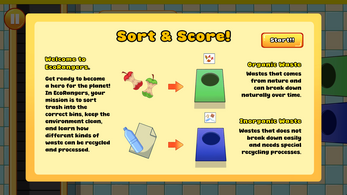
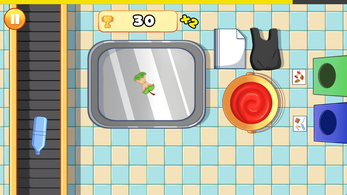
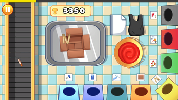

# 🌍 EcoRangers

**Sort fast, score big, and save the planet, one piece of trash at a time.**

EcoRangers is a fast-paced 2D arcade sorting game built in Unity. Trash keeps streaming in, and it's up to you to sort it quickly and accurately. Keep your combo alive, beat the clock, and chase the highest score while making the world a little cleaner.

**▶️ [Play it on itch.io](https://akj16.itch.io/ecorangers)** (runs in your browser)

---

## 📸 Screenshots

<p align="center">
  
  
  
</p>

---

## 🎮 How to Play

| Action | Control |
| --- | --- |
| Interact with objects and menus | **Click** |
| Grab and move trash or tools | **Click + Drag** |

**Tips:**
- Keep up with the stream of waste.
- Keep your combo going for a higher score.
- Watch the clock.

---

## ✨ Features

- Fast-paced 2D arcade gameplay
- Simple click-and-drag controls
- Trash arrives on a conveyor belt and must be sorted into the correct bins
- Combo multiplier and scoring system
- Built-in tutorial that explains organic vs. inorganic waste
- More bins appear as the game progresses
- Time-pressure challenge
- Educational theme about waste sorting and recycling
- Playable on HTML5 (browser), Windows, and mobile

---

## 📥 Download & Play

| Platform | Link |
| --- | --- |
| Browser (HTML5) | [akj16.itch.io/ecorangers](https://akj16.itch.io/ecorangers) |
| Windows | Download `EcoRangers - Windows PC.zip` from the [itch.io page](https://akj16.itch.io/ecorangers) |

---

## 🛠️ Building from Source

EcoRangers is a Unity project.

### Requirements
- [Unity Hub](https://unity.com/download) and the Unity Editor version listed in `ProjectSettings/ProjectVersion.txt`
- (Optional) Visual Studio with the workloads listed in `.vsconfig`

### Steps
1. Clone the repository:
   ```bash
   git clone https://github.com/AKJ16/EcoRangers.git
   ```
2. Open **Unity Hub** → **Add** → select the cloned `EcoRangers` folder.
3. Install the matching Unity Editor version if prompted.
4. Open the project and load the main scene from `Assets/Scenes`.
5. Press **Play** to run in the editor, or use **File → Build Settings** to build for Windows or WebGL.

---

## 📁 Project Structure

```
EcoRangers/
├── Assets/            # Game scenes, scripts, art, and audio
├── Packages/          # Unity package dependencies
├── ProjectSettings/   # Unity project configuration
├── screenshots/       # Images used in this README
├── .gitattributes
├── .gitignore
└── .vsconfig          # Visual Studio workload configuration
```

---

## 🙌 Credits

- **Game design and development:** [AKJ16](https://github.com/AKJ16)
- **Art:** Jocelyn Tania Harjanto ([Instagram](https://www.instagram.com/jocelyn_tania_))
- **UI, menu, and gameplay sounds:** [JDSherbert](https://jdsherbert.itch.io)
- **Additional SFX:** [freesound_community](https://pixabay.com/users/freesound_community-46691455/), [DRAGON-STUDIO](https://pixabay.com/users/dragon-studio-38165424/), and [kakaist](https://pixabay.com/users/kakaist-48093450/) via Pixabay

---

## 🤖 AI Disclosure

AI assistance was used in the development of this project's code.

---

## 📄 License

The source code in this repository is released under the [MIT License](LICENSE).

Third-party assets (art, music, and sound effects) are credited above and remain the property of their respective creators. They are subject to their own licenses and are not covered by the MIT License.
